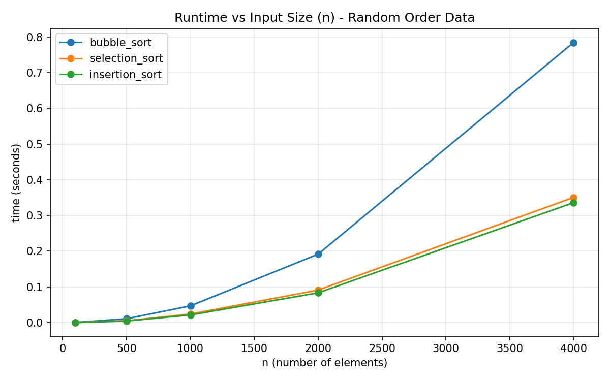
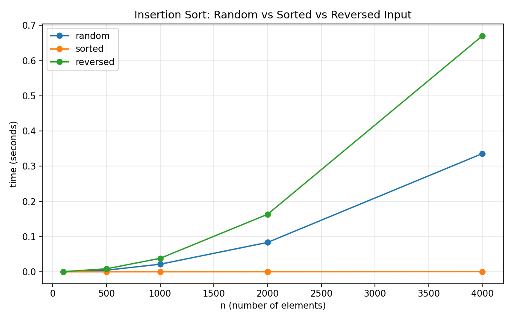

# Sorting Algorithms on Real-World Big Data

Benchmarking **Bubble Sort**, **Selection Sort** and **Insertion Sort** (all written from scratch in Python) on real airline flight data, then using the measurements to estimate how long each one would take on a full multi-million-row dataset, compared against Python's built-in `sorted()` (Timsort).

[](https://www.kaggle.com/code/f240622aliamir/sorting-algos-time-complexity-a2)

---

## What this project does

O(n²) sorting algorithms are easy to understand but are known to be slow on big inputs. This project shows how slow, with real numbers instead of just theory:

1. Load a real, multi-million-row dataset **in chunks** so it never has to fit in RAM.
2. Draw small random samples from it (100 to 4,000 values).
3. Sort each sample with the three algorithms, in three orderings: **random** (average case), **already sorted** (best case) and **reverse sorted** (worst case).
4. Time everything with `time.perf_counter()` and save the results to CSV.
5. Fit `time = c × n²` from the largest sample and **extrapolate** to the full dataset.
6. Compare that estimate with Python's `sorted()` to get a speedup factor.

The big dataset is the source of realistic data; the O(n²) sorts only ever run on the small samples. Running them on millions of rows directly is exactly what the extrapolation shows to be impractical.

## Dataset

[Airline Delay and Cancellation Data, 2009-2018](https://www.kaggle.com/datasets/yuanyuwendymu/airline-delay-and-cancellation-data-2009-2018) on Kaggle: U.S. domestic flights, one CSV per year.

| Setting | Value |
|---|---|
| File used | `2013.csv` (set by `YEARS_TO_USE` in the script) |
| Rows in that file | about 6.37 million |
| Numeric column sorted | `ARR_DELAY` (arrival delay, minutes) |
| Text column sorted | `OP_CARRIER` (airline code) |
| Random seed | 42 |

The dataset is **not** included in this repo (it is several GB and belongs to Kaggle).

## How it works

- **Chunked loading:** `pd.read_csv(..., chunksize=1_000_000)` reads the file one million rows at a time. From each chunk, up to 20,000 random rows are kept as a sampling pool, and the chunk is thrown away. Total row count is tracked across all chunks.
- **Sample orderings:** `make_sample_orderings()` draws `n` values, then builds the random, ascending and descending versions. Python's built-in `sorted()` is used *only here* to prepare test data, never inside the three algorithms.
- **Algorithms:** `bubble_sort`, `selection_sort`, `insertion_sort`, each with a docstring stating best/average/worst complexity and stability. They work on numbers and strings.
- **Correctness tests:** run before any benchmarking, comparing each algorithm against `sorted()` on random, sorted, reversed, duplicate, string, single-item and empty inputs.
- **Fair benchmarking:** every algorithm gets its own copy of the same input.
- **Safety limit:** `MAX_SECONDS_PER_RUN = 30`. If an algorithm exceeds it at some size, larger sizes for that algorithm are skipped and recorded as `None`, not guessed.

| Algorithm | Best | Average | Worst | Stable |
|---|---|---|---|---|
| Bubble Sort (with early exit) | O(n) | O(n²) | O(n²) | Yes |
| Selection Sort | O(n²) | O(n²) | O(n²) | No |
| Insertion Sort | O(n) | O(n²) | O(n²) | Yes |

## Results

Sample sizes: 100, 500, 1000, 2000, 4000. Full timings are in [`results/sort_benchmark_results.csv`](results/sort_benchmark_results.csv).

### Random-order data (seconds)

| n | Bubble | Selection | Insertion |
|---|---|---|---|
| 100 | 0.000435 | 0.000226 | 0.000154 |
| 500 | 0.010851 | 0.005207 | 0.004580 |
| 1000 | 0.046950 | 0.024012 | 0.021512 |
| 2000 | 0.191768 | 0.091103 | 0.083483 |
| 4000 | 0.784376 | 0.350620 | 0.335968 |



### Insertion Sort: best vs average vs worst case (seconds)

| n | Random | Sorted | Reversed |
|---|---|---|---|
| 1000 | 0.021512 | 0.000124 | 0.038227 |
| 2000 | 0.083483 | 0.000236 | 0.163317 |
| 4000 | 0.335968 | 0.000451 | 0.670715 |



### Text vs numeric (n = 2000)

Sorting `OP_CARRIER` (strings) was slower than `ARR_DELAY` (numbers) in all 9 combinations of algorithm and ordering. For example, Selection Sort on random data took 0.124 s for text vs 0.091 s for numbers. Comparing strings means checking characters one by one, so each comparison costs a bit more.

### Extrapolation to the full file (estimates, not measured)

Using `time = c × n²` with `c` taken from the n = 4000 random-order run, and about 6.37 million rows:

| Algorithm | Estimated time for the full file | Compared with Timsort |
|---|---|---|
| Bubble Sort | about 23.0 days | about 1,133,000x slower |
| Selection Sort | about 10.3 days | about 507,000x slower |
| Insertion Sort | about 9.9 days | about 485,000x slower |
| Python `sorted()` (Timsort) | about 1.75 seconds | baseline |

These are projections from a simple growth model. The three algorithms were never run on the full file.

### Key takeaways

- On random data Insertion Sort was fastest, Selection Sort close behind, Bubble Sort slowest (more than 2x slower at n = 4000). All three curves bend upward as O(n²) predicts.
- Insertion Sort is almost instant on sorted input (O(n) best case) and slowest on reversed input (O(n²) worst case). Selection Sort barely changes with input order.
- At millions of rows, O(n²) sorting takes days while Timsort takes seconds, which is why real software uses O(n log n) algorithms.
- These simple sorts are still fine for small or nearly-sorted data.

## Repository structure

```
Sorting-Algorithms-Benchmark/
├── sorting_assignment.py          # all code: loading, sorts, tests, benchmarks, charts, extrapolation
├── results/
│   ├── sort_benchmark_results.csv # size, ordering, algorithm, time_seconds
│   ├── runtime_vs_n.png
│   └── insertion_sort_cases.png
├── requirements.txt
├── LICENSE
└── README.md
```

## How to run it

### On Kaggle (recommended)

1. Open the [dataset page](https://www.kaggle.com/datasets/yuanyuwendymu/airline-delay-and-cancellation-data-2009-2018) and click **New Notebook**, or open the [notebook](https://www.kaggle.com/code/f240622aliamir/sorting-algos-time-complexity-a2) and make sure the dataset is attached under **Input**.
2. Paste the code from `sorting_assignment.py` into notebook cells. Splitting it into cells (imports and config, function definitions, load data, tests, benchmark, charts, extrapolation) lets you re-run one part without reloading the data.
3. Set `DEMO_MODE = False`.
4. Run the cells in order. Click **Save Version** to keep the output files, because files in `/kaggle/working` disappear if the session restarts.

The script finds the dataset folder automatically under `/kaggle/input/`. The yearly files in your copy may differ, so check the file list printed when the data loads and set `YEARS_TO_USE` to a year that exists.

### Locally (Windows, macOS, Linux)

1. Install packages: `pip install -r requirements.txt`
2. Create a Kaggle API token (Kaggle → Settings → Create New API Token) and put `kaggle.json` in `C:\Users\<you>\.kaggle\` on Windows, or `~/.kaggle/` on macOS/Linux.
3. Download the data:
   ```
   kaggle datasets download -d yuanyuwendymu/airline-delay-and-cancellation-data-2009-2018 -p ./data --unzip
   ```
4. In `sorting_assignment.py`, add this line in the config section:
   ```python
   LOCAL_DATA_FOLDER = "./data"
   ```
   and in `load_data()` change
   ```python
   base = find_kaggle_dataset_path()
   ```
   to
   ```python
   base = LOCAL_DATA_FOLDER or find_kaggle_dataset_path()
   ```
5. Set `DEMO_MODE = False` and run `python sorting_assignment.py`.

> `DEMO_MODE = True` uses a small fake dataset so the pipeline can be tested without downloading anything. Its numbers are not real results.

## Using more of the dataset (two or more years)

The default run uses one yearly file. To use more:

1. Change one line in the config:
   ```python
   YEARS_TO_USE = ["2011", "2013"]     # any years that exist in your attached dataset
   ```
   The names must match the CSV files listed when the data loads. Nothing else in the code needs to change: the loader already loops over the years, adds up the row counts, and the extrapolation automatically uses the combined total.
2. Re-run from the data-loading cell onwards (or **Run All**) so the sampling pool and `total_rows` are refreshed.
3. Update any numbers you copy into a report.

**Memory:** it stays low. Only one 1,000,000-row chunk is held at a time, plus a pool of up to 20,000 rows per chunk.

**Run time:**
- *Loading* grows roughly in proportion to the number of years, because each file is read once. Use how long the load cell took for one year as your yardstick: two years takes about twice as long, and so on.
- *Benchmarking* does not change. It sorts the same small samples, and the measured sorting time in `sort_benchmark_results.csv` adds up to only about 5 seconds.
- *Extrapolated sorting time* grows with the **square** of the row count, so it climbs fast. Rough projection, assuming each year has about 6.37 million rows (real years differ a little):

| Years used | Rows (approx.) | Insertion Sort | Selection Sort | Bubble Sort | Timsort |
|---|---|---|---|---|---|
| 1 | 6.4 M | about 10 days | about 10 days | about 23 days | about 1.8 s |
| 2 | 12.7 M | about 39 days | about 41 days | about 92 days | about 3.7 s |
| 3 | 19.1 M | about 89 days | about 93 days | about 207 days | about 5.6 s |
| 6 | 38.2 M | about 1 year | about 1 year | about 2.3 years | about 12 s |

Re-running will give slightly different numbers because the timings are re-measured. The pattern is the point: doubling the data makes the O(n²) sorts about 4x slower, while Timsort only slightly more than doubles.

## License

MIT, see [LICENSE](LICENSE).

## Author

Ali Amir, BS Computer Science, FAST-NUCES Faisalabad. GitHub: [@aliamir26](https://github.com/aliamir26)
